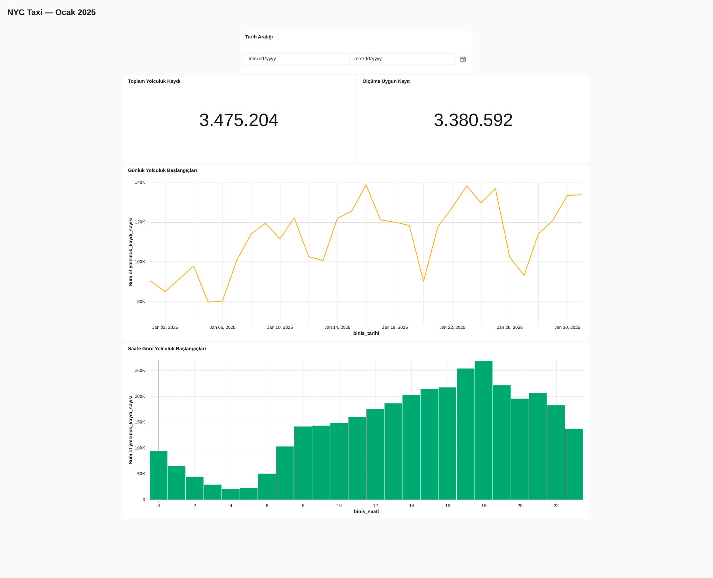

# NYC Taxi — Databricks Analysis

A Databricks portfolio project that turns January 2025 Yellow Taxi records into a quality-aware Silver table, a day/hour Gold summary, and an interactive dashboard.

**Stack:** Databricks Free Edition · PySpark · SQL · Delta Lake · Unity Catalog Volumes · Databricks dashboards

**Status:** completed batch analysis and Delta learning project. The notebooks and documentation are packaged for review; see [verification status](docs/VALIDATION.md) for the distinction between recorded results and the edited code.

[View the dashboard PDF](dashboard/nyc_taxi_january_2025.pdf)

## Question and scope

How do January pickup volumes vary by date and hour, how do eligible trip measurements differ by pickup location, and how can implausible measurements be flagged without losing the original volume count?

The project analyzes **records**, not unique passengers, vehicles, or guaranteed unique journeys. Pickup timestamps determine the January window. All January records are retained in Silver; distance and duration averages use only the measurement-eligible subset.

## Recorded results

| Measure | January 2025 baseline |
|---|---:|
| Raw Parquet records | 3,475,226 |
| Records outside the January pickup window | 22 |
| January records retained in Silver | **3,475,204** |
| Measurement-eligible records | **3,380,592 (97.28%)** |
| Measurement-ineligible records retained for volume analysis | 94,612 |
| Gold day/hour groups | **744** |
| Distance/duration candidates above 80 mph | 857 |

The candidate speed maximum was approximately **67,608 mph**, produced by 18.78 miles recorded over one second. It is an implausible derived value requiring investigation. The 80 mph threshold is a project screening rule, not a legal speed limit.

Recorded descriptive findings:

- The largest month-wide pickup-hour count was **18:00–18:59: 267,951 records**; the smallest was **04:00–04:59: 20,033**.
- Eligible Manhattan pickups had a mean distance of **2.28 miles** and duration of **12.78 minutes**; eligible Queens pickups averaged **12.02 miles** and **31.45 minutes**.
- JFK and LaGuardia accounted for **231,080** of the **283,713** eligible Queens pickup records. This describes the population mix; it does not establish a causal explanation for the borough averages.

Evidence is retained in the notebook tables and [recorded result extracts](results/README.md). These are supplied Databricks outputs, not a fresh recomputation by the packaging environment.

## Data sources

The primary analysis uses external [NYC Taxi & Limousine Commission trip-record data](https://www.nyc.gov/site/tlc/about/tlc-trip-record-data.page):

- [January 2025 Yellow Taxi Parquet](https://d37ci6vzurychx.cloudfront.net/trip-data/yellow_tripdata_2025-01.parquet)
- [Taxi Zone Lookup CSV](https://d37ci6vzurychx.cloudfront.net/misc/taxi_zone_lookup.csv)
- [Yellow Taxi data dictionary](https://www.nyc.gov/assets/tlc/downloads/pdf/data_dictionary_trip_records_yellow.pdf)

Notebook **01** is a separate introductory exercise on `samples.nyctaxi.trips`, with recorded 2016 sample data. It does not supply the January 2025 analysis or dashboard. The January pipeline begins at notebook **02**.

The raw files are downloaded separately and uploaded into a Unity Catalog Volume. They are not bundled in this repository. TLC publishes provider-reported data and does not guarantee its accuracy. See [source notes](docs/DATA_SOURCES.md).

## Data flow

| Stage | Artifact | Purpose |
|---|---|---|
| Bronze input | Parquet + zone CSV in `/Volumes/workspace/default/nyc_taxi_raw/` | Preserve raw external files |
| Silver | `workspace.default.nyc_taxi_silver_2025_01` | January filter, elapsed duration, location enrichment, quality labels and eligibility |
| Gold | `workspace.default.nyc_taxi_gold_gun_saat_2025_01` | Day/hour counts and eligible-only measurement means |
| Presentation | Databricks dashboard | Date filter, two counters, daily line chart and hourly bar chart |
| Delta exercise | `workspace.default.nyc_taxi_delta_deneme` | One-row UPDATE, historical read and RESTORE demonstration |

There is no separate persisted Bronze Delta table in this implementation. The raw Volume files provide the Bronze input. Silver and Gold use `CREATE OR REPLACE TABLE` for repeatable full refreshes; no incremental loading is claimed.

## Measurement eligibility

A January record is eligible when all conditions hold:

- Distance is **> 0 and <= 100 miles**.
- Duration is **> 0 and <= 180 minutes**.
- Derived average speed is **<= 80 mph**, calculated as `distance_miles * 60 / duration_minutes`.
- Null eligibility expressions map to `false`.

There is **no minimum of three minutes**. Fare sign, fare amount, and missing rate codes are not eligibility conditions. Records are not deduplicated. Detailed rules and limits are in [DATA_QUALITY.md](docs/DATA_QUALITY.md).

## Run the project

1. Follow [SETUP.md](docs/SETUP.md) to create the Volume and upload the two TLC files.
2. Import the five `.ipynb` files from `notebooks/` into Databricks.
3. Run **02 → 03 → 04 → 05**, top to bottom within each notebook. Notebook 01 is optional; 03 is optional when only building the Gold table.
4. Use [dashboard_dataset.sql](sql/dashboard_dataset.sql) and [DASHBOARD.md](docs/DASHBOARD.md) to reconstruct the interactive dashboard.
5. Run [validation_queries.sql](sql/validation_queries.sql) after the packaged notebooks execute. Expected baseline values are in [VALIDATION.md](docs/VALIDATION.md).

These notebooks require Databricks `spark`, `display`, `%sql`, Unity Catalog access, and a Python environment exposing `F.timestamp_diff` (PySpark 4.0+). They are not ordinary local Jupyter notebooks. Installing `requirements-dev.txt` validates the package format locally; it does not provide a Databricks runtime.

## Repository guide

| Path | Contents |
|---|---|
| `notebooks/` | Five curated notebooks with teaching notes and selected recorded outputs |
| `source/` | Matching Databricks `.py`/`.sql` source exports; an alternative import format |
| `sql/` | Dashboard dataset query and post-run validation queries |
| `docs/` | Setup, source context, quality rules, data dictionary, dashboard reconstruction, verification and packaging changes |
| `dashboard/` and `images/` | Supplied dashboard PDF and its rendered preview |
| `results/` | Recorded metrics, 24 hourly counts, and January 1 Gold sample |
| `scripts/check_package.py` | Notebook-format, Python/SQL syntax, local-link and result-reconciliation checks |

## Scope and limits

This delivery covers manual batch execution, SQL/PySpark analysis, Delta history/Time Travel/RESTORE, and a published dashboard from the original user session. Automated Jobs, streaming, incremental ingestion, fare accounting, passenger-level deduplication, and causal analysis are outside the delivered scope. The dashboard PDF is static; the repository includes reconstruction instructions and its dataset query, not a native dashboard layout export.

## Author and license

**Recep Erecek** · [GitHub](https://github.com/receperecek) · [LinkedIn](https://www.linkedin.com/in/recep-erecek/)

Project code and documentation use the [MIT License](LICENSE). The license does not relicense third-party TLC data; source attribution and applicable source terms remain separate.
